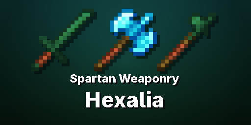

# Spartan Weaponry: Hexalia

A [Spartan Weaponry](https://www.curseforge.com/minecraft/mc-mods/spartan-weaponry) addon for Minecraft 1.20.1 (Forge). It adds two [Hexalia](https://www.curseforge.com/minecraft/mc-mods/hexalia) weapon tiers to all 24 Spartan weapon types. Both are crafted at Hexalia's Ritual Table, the way Hexalia makes its own weapons.

| Tier | Ritual | Traits |
|---|---|---|
| Ancient (Hexalia's Ancient tier) | Center Ancient Seed; offerings: iron Spartan weapon, Earth Node, Tree Resin, Rooted Dirt, Spirit Powder | Rootbind I (Slowness II for 1.5 s on hit) |
| Celestial (a step above diamond) | Center Celestial Crystal; offerings: the Ancient weapon, Air, Water and Fire Nodes, Spirit Powder, Amethyst Shard | Rootbind II (3 s), Moonlit (+35% damage at night) |

**Requires:** Spartan Weaponry, Spartan Weaponry Addon Toolkit, Hexalia.

## Building
- `./gradlew build` (Java 17). Put the dependency jars in `libs/` as `spartanweaponry-3.2.1.jar`, `spartantoolkit-1.6.1.jar` and `hexalia-1.3.7.jar`.
- `python3 tools/gen_assets.py` regenerates every resource, and needs ImageMagick.

## License
MIT. See [LICENSE](LICENSE) and [NOTICE](NOTICE).
